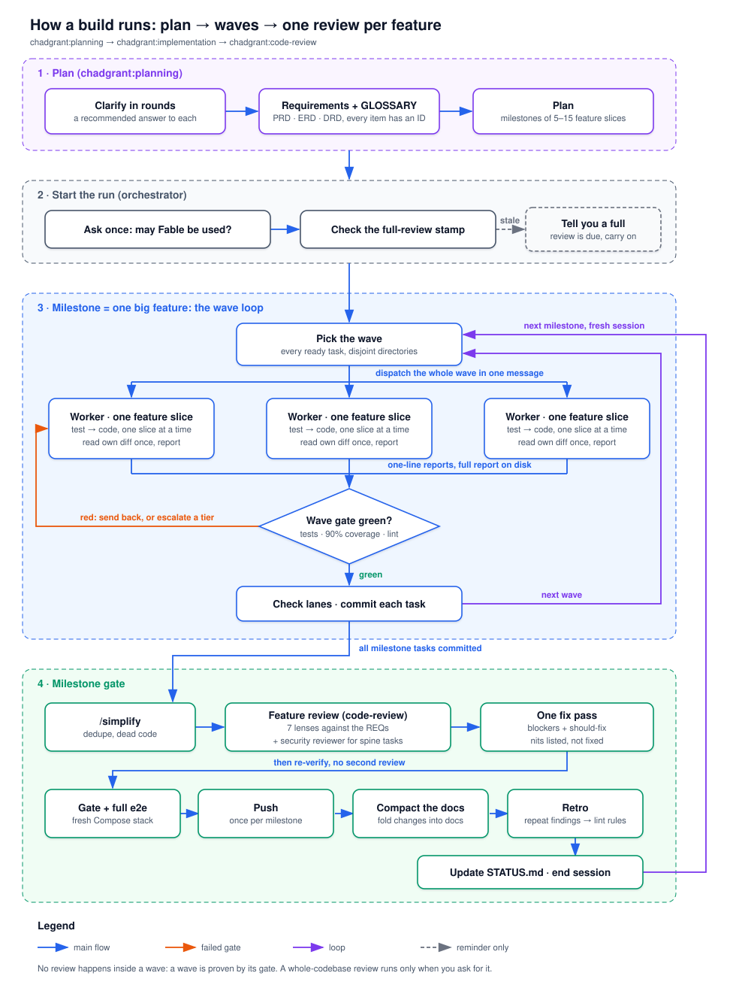
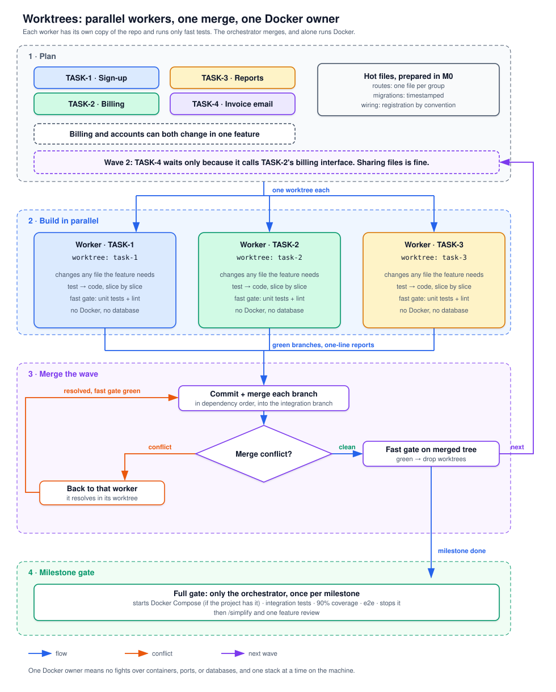

# skills

A collection of [Agent Skills](https://agentskills.io) for coding agents (Claude Code and any agent supporting the [Agent Skills spec](https://agentskills.io/specification)).

## Skills

Three of these form one pipeline — **plan → implement → review** — so you can spend your day talking requirements and let the software factory build them. One more skill, `chadgrant:clean-code`, sits underneath and holds the standards the pipeline builds and reviews against:

| Skill | Stage | What it does |
| --- | --- | --- |
| [`chadgrant:planning`](skills/planning/) | **Plan** | A planning loop that produces a living family of requirements docs (PRD, ERD, DRD, API contract, UX and ops docs) with small Excalidraw diagrams, kept in sync by a shared ID spine, and a routed implementation plan for the implementation stage. Also re-syncs docs with code, including brownfield repos, and compacts the docs so changes fold into the requirements instead of piling up as a log. Connector-ready for Confluence/Jira. |
| [`chadgrant:implementation`](skills/implementation/) | **Implement** | One skill, two roles, each in its own file so an agent loads only its own. **Orchestrator**: plans the work as feature slices (one user-visible capability end to end per worker, usually 5–15 per project), routes each to a model tier (asking before using Fable), dispatches full waves of subagents, each in its own git worktree, merges them and runs one fast gate (unit tests and static checks) per wave, runs the full gate (Docker-backed integration tests, coverage, e2e) itself once per milestone, and has each finished milestone feature reviewed once, with one fix pass. It treats its own context as the budget (one session per milestone, reports on disk, investigation delegated), and times every run, wave, task, gate, and review in a per-project journal (`~/.claude/journal/<repo>.jsonl`) whose `report --all` compares runs. Plugin hooks log every subagent automatically (wall time, model wait time, tokens, model, and whether it ran on Anthropic, Bedrock, Vertex, or a gateway) and every API failure; `report --providers` compares providers. **Worker**: builds one task verify-first, clean per `chadgrant:clean-code`, UI with Impeccable, services Twelve-Factor, with a debug loop for red tests and a rigorous way to receive review; runs only the fast gate, never Docker; never commits and never touches shared files. |
| [`chadgrant:code-review`](skills/code-review/) | **Review** | The adversarial reviewer. Seven lenses (spec, correctness, security, tests, design, Twelve-Factor, readability), every finding with `file:line` and a breaking case. The design lens prescribes by name ("use a Decorator here", "this needs a Repository") from evidence in the code, and flags patterns to remove. Scoped to a task or feature's files when dispatched by the pipeline; the entire codebase when run on its own. Keeps a `Last full review` stamp in the repo's `AGENTS.md`; when it goes stale (14 days or 50 commits) the pipeline reminds you that a full review is due and leaves the decision to you. |
| [`chadgrant:clean-code`](skills/clean-code/) | *(standards)* | How to write and review any unit of code well: Robert C. Martin's *Clean Code* + SOLID, the four simplicity rules every other skill cites (**KISS**, **YAGNI**, **DRY**, **convention over configuration**), **Clean Architecture**, and **Construction** (McConnell's *Code Complete*). Its reference files, opened only when the problem calls for one, carry the **Gang of Four** and **Fowler PoEAA** pattern catalogs, **Evans' domain-driven design**, and **Fowler's refactoring** catalog. Applied whenever the agent writes, modifies, or reviews code. |

## How it works

A build runs top down: plan the milestones, run each milestone as waves of parallel workers proven by one gate per wave, then review each finished feature once.



Workers run in parallel without colliding because each one gets its own git worktree and runs only the fast gate, so no two agents fight over files, Docker, ports, or a database. The orchestrator merges their branches and is the only one that starts backing services.



## Install

These ship as one Claude Code plugin, `chadgrant`:

```sh
claude plugin marketplace add chadgrant/skills
claude plugin install chadgrant@chadgrant-skills
```

Or inside Claude Code: `/plugin install chadgrant --marketplace chadgrant/skills`. The skills then appear as `chadgrant:planning`, `chadgrant:implementation`, `chadgrant:code-review`, and `chadgrant:clean-code`. `claude plugin update chadgrant@chadgrant-skills` picks up new versions.

Other agents supporting the [Agent Skills spec](https://agentskills.io/specification) can copy a folder from `skills/` into their skills directory; the skills refer to each other by their plugin names, so drop the `chadgrant:` prefix there.

Each skill's `SKILL.md` (with its reference files) is the authoritative doc.
