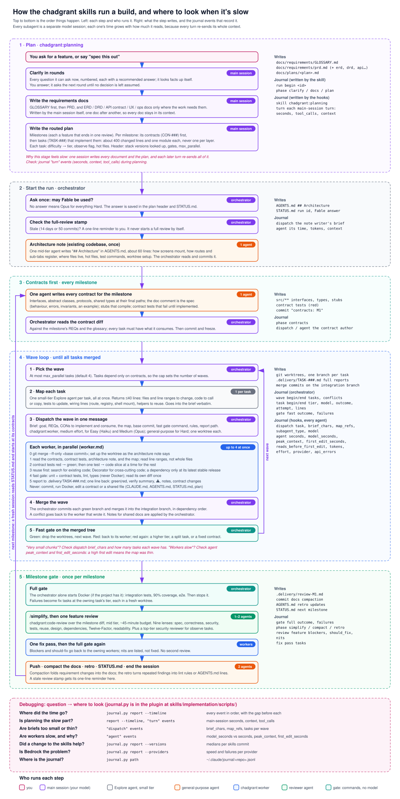

# skills

A collection of [Agent Skills](https://agentskills.io) for coding agents (Claude Code and any agent supporting the [Agent Skills spec](https://agentskills.io/specification)).

## Skills

Use **investigate → plan → implement → verify → review** as needed, or invoke the skill that fits the task. Skip stages that add no value to a small task. [Clean code](skills/clean-code/SKILL.md) supplies shared standards.

| Skill | Use it for | Entry point |
|---|---|---|
| `chadgrant:investigation` | Explain code/design or diagnose a failure with a bounded evidence trail | [Choose the question](skills/investigation/SKILL.md) |
| `chadgrant:verification` | Prove runtime behavior and maintain reusable launch/drive/cleanup instructions | [Run a proof](skills/verification/SKILL.md) |
| `chadgrant:planning` | Author requirements/plans, refine one doc, reconcile with code, or compact history | [Choose a mode](skills/planning/SKILL.md) |
| `chadgrant:implementation` | Execute a plan or one task, verify, and integrate | [Choose a role](skills/implementation/SKILL.md) |
| `chadgrant:code-review` | Review a supplied change or an explicitly requested whole-codebase audit | [Choose scope](skills/code-review/SKILL.md) |
| `chadgrant:clean-code` | Write, refactor, or review code with Clean Code, SOLID, and simplicity principles | [Standards and design references](skills/clean-code/SKILL.md) |

### Context and delegation

Entry points load shared rules and route to the relevant procedure. Read only that mode, selected templates, and needed reference sections. The pattern/domain/refactoring catalogs remain available without loading them for routine edits.

Implementation and investigation prefer **Forks when available** for authorized delegation; independent review prefers fresh context. Implementation reuses inherited context and keeps file edits in separate worktrees. [Delegation guidance](skills/implementation/delegation.md) covers role boundaries and fallbacks for different models or restricted tools. A self-evident solo task needs no formal orchestration.

Workers return one-line results; full evidence stays in `.delivery/`. [Journal commands](skills/implementation/journal.md) expose timing, tokens, provider failures, and comparisons across skill versions. Smaller prompts reduce context load; actual spend depends on model, cache reuse, turns, and generated output.

## How it works

For a multi-task build, write milestone contracts first, implement cohesive modules in bounded parallel waves, run the fast gate per wave, then the full gate and one feature review per milestone. Keep contracts frozen during parallel implementation; workers report change requests. The orchestrator owns commits, shared docs, and backing services.

For debugging, a detailed version shows every step, who runs it, what it writes, and which journal events record it, with a question → where-to-look table:




Workers run in parallel without colliding because each one gets its own git worktree and runs only the fast gate, so no two agents fight over files, Docker, ports, or a database. The orchestrator merges their branches and is the only one that starts backing services.


## Install

These ship as one Claude Code plugin, `chadgrant`:

```sh
claude plugin marketplace add chadgrant/skills
claude plugin install chadgrant@chadgrant-skills
```

Or inside Claude Code: `/plugin install chadgrant --marketplace chadgrant/skills`. The six skills appear with the `chadgrant:` prefix shown above. `claude plugin update chadgrant@chadgrant-skills` picks up new versions.

For Codex and other agents supporting the [Agent Skills spec](https://agentskills.io/specification), install all six folders from `skills/` as siblings in the agent's skills directory so cross-skill links and scripts resolve. Use the skill names without the Claude plugin's `chadgrant:` prefix. `clean-code` also supports standalone installation; its review handoff is optional when `code-review` is absent.

Each skill's `SKILL.md` (with its reference files) is the authoritative doc. [Handoff fields](skills/implementation/handoffs.md) preserve scope, revision, evidence, and authorization across skills; [host adapters](skills/implementation/hosts.md) translate Claude/Codex tools only when needed.

Selected investigation, verification, review, and design practices were adapted from pstack; see [sources and attribution](THIRD_PARTY_NOTICES.md). The collection intentionally avoids mandatory design competitions, blanket agent fan-out, automatic rule accumulation, and a second session router. Performance, delivery automation, and formal-verification skills remain deferred until recurring use justifies them.
